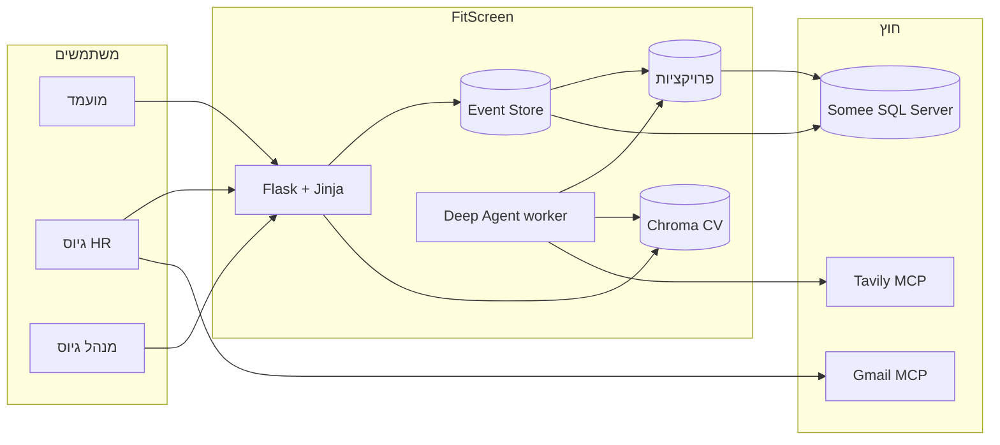

# 00 — חזון המערכת (FitScreen)

## תחום נעול: גיוס בלבד

המפרט של הקורס נותן בסעיף 1 דוגמאות כלליות (טיסות, חדשות, אירוע) ובסעיף 4.5 דוגמת "קניית כרטיס טיסה".  
החלקים **המחייבים** של אותו מפרט (4.4, NFR 6, NFR 11, הדוגמה בסעיף 5, ותרשים Candidate Screening) מתארים מערכת **משרות ומועמדים**.

**החלטה:** FitScreen היא מערכת סינון מועמדים. אין טיסות, אין כרטיסים, אין ערבוב מטאפורות במסכים או במסמכים.  
סעיף 4.5 ממומש כהזנת משרה והגשת מועמדות עם קורות חיים.

## הבעיה

צוות גיוס מקבל עשרות קורות חיים למשרה. הסינון הידני איטי ולא אחיד. אין תיעוד של למה מועמד התקדם או נדחה, ואין שימוש שיטתי בתוכן ה-CV מול דרישות המשרה.

## הפתרון

FitScreen היא מערכת מידע לגיוס:

1. מנהל גיוס מאשר פתיחת משרה.
2. HR מפרסם דרישות מובנות (חובה / רצוי).
3. מועמד מחפש משרה, רואה פרטים, ומגיש מועמדות עם קובץ CV.
4. סוכן AI בתהליך נפרד קורא את הרשומה, מטמיע את ה-CV במסד וקטורי, משווה סמנטית למשרה, בודק כיסוי דרישות, ומחפש באינטרנט ראיות (Tavily).
5. HR רואה דוח, מחליט לקבל / לדחות / להזמין לראיון. ההחלטה נשמרת כאירוע; ניתן לשלוח מייל (Gmail MCP).

## משתמשים

| תפקיד | מטרה |
|---|---|
| Candidate | למצוא משרה פתוחה ולהגיש מועמדות |
| HR | לנהל משרות, לראות מועמדים והערכת סוכן, להחליט |
| HiringManager | לאשר פתיחת משרה ולראות דשבורד ארגוני |

## ערך

- החלטת גיוס מבוססת ראיות (CV + RAG + רשת), לא תחושת בטן בלבד.
- עקיבות מלאה: כל שינוי הוא אירוע (Event Sourcing).
- הפרדת קריאה/כתיבה (CQRS) כדי שהדשבורד והחיפוש לא יישענו על אותה לוגיקת עדכון.

## תרשים הקשר

## מסע משתמש (בלי הנחות)

1. HR נרשם, יוצר משרה במצב Draft עם כישורי חובה/רצוי.
2. HiringManager נרשם, מאשר JobOpened. רק אז מועמד יכול להגיש.
3. מועמד מחפש משרה פתוחה, פותח פרטים, מעלה CV (TXT או PDF עם טקסט).
4. תהליך `python -m agent.worker` (לא בקשת הדפדפן) קורא מועמדות Submitted, מריץ כלים + RAG + Tavily, כותב ApplicationScreeningCompleted.
5. HR רואה דשבורד (משרות פתוחות + מספר נרשמים), נכנס למועמדות, מחליט Interview / Reject / Offer.

## מחוץ לגבול

- אין תשלום, אין SSO ארגוני, אין לוח ראיונות מלא (רק סטטוס Interview).
- אין SPA/React. ממשק Jinja.
- Somee מארח את מסד הנתונים בלבד, לא את תהליך Flask.
