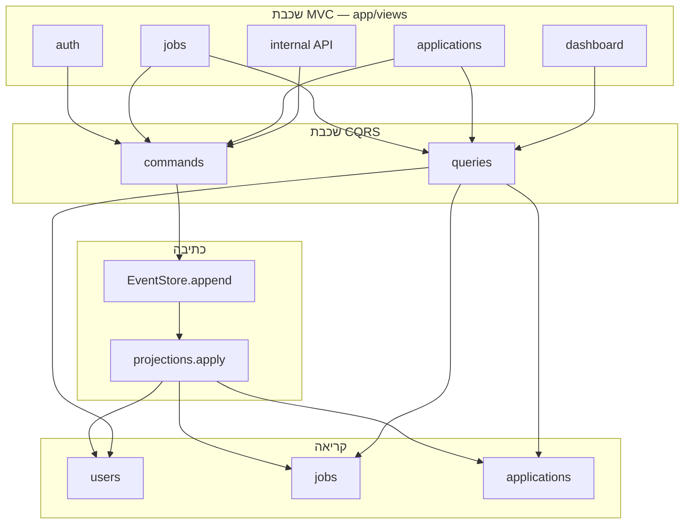
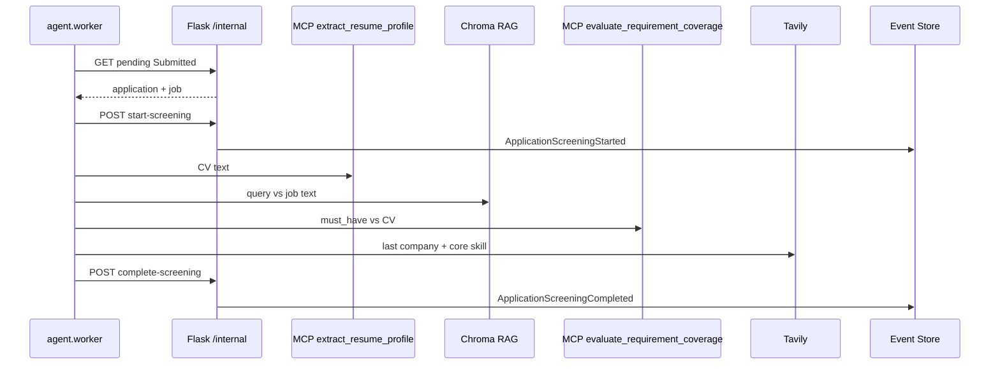

# 02 — ארכיטקטורה

## תרשים רכיבים



## סגנון

שרת Flask במבנה **MVC** לשכבת ה-HTTP, ושירותים פנימיים ב-**CQRS**:

- **Command model:** ולידציה, לוגיקה, append ל-Event Store, הפעלת פרויקציה.
- **Query model:** קריאה בלבד מטבלאות פרויקציה (משרות, מועמדויות, דשבורד).

זה תואם לתרשים 1 של הקורס: שינוי מה-UI הולך ל-Command; תצוגות מתעדכנות מ-Query.

## תהליכים

1. **Web (Flask)** — ממשק משתמש + API פנימי לסוכן (`POST /internal/commands/record-screening`).
2. **Worker (Deep Agent)** — process נפרד. **קורא רשומות ממסד הנתונים** (`pending_screening`), מריץ Google ADK + כלי MCP Studio + Tavily MCP + RAG, כותב אירוע `ApplicationScreeningCompleted`.
3. **Somee SQL Server** — Event Store ופרויקציות בענן.
4. **Chroma** — וקטורי CV על דיסק מקומי (`chroma_data/`).

## זרימת כתיבה

```
UI POST → View → Command handler → EventStore.append
  → Projection.apply → Query tables
```

## זרימת קריאה

```
UI GET → View → Query handler → SELECT מטבלאות פרויקציה
```

## זרימת סוכן (תרשים 2)



תהליך נפרד חובה: `python -m agent.worker`. Flask לבדו לא מעריך מועמדים.

## אבטחה

- Cookie session.
- `@login_required` + `@role_required`.
- מפתח פנימי `AGENT_API_KEY` לקריאות ה-worker.

## תלות חיצונית

| שירות | פרוטוקול | תפקיד |
|---|---|---|
| Somee | TDS/SQL | Event Store + read models |
| Tavily | MCP / HTTP | חיפוש אינטרנט |
| Gmail | MCP | מייל החלטה |
| Ollama או Gemini | LLM | מודל הסוכן |

Flask **לא** מאוחסן ב-Somee (Somee לא מריץ Python על hosting חינמי).
