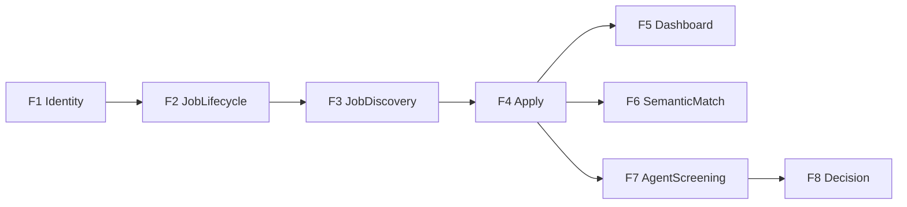

# 04 — פיצ'רים (יחידות פונקציונליות שלמות)

כל פיצ'ר כולל: מסך או API, Command ו/או Query, אירוע אם יש כתיבה, ובדיקה. לא מממשים "מחלקה בודדת" כמשימה.

## F1 Identity — FR-2, FR-3

- הרשמה עם בחירת תפקיד (בסביבת הקורס; בפרודקשן HR יוזמנו).
- התחברות / התנתקות.
- תפריט לפי תפקיד.

## F2 JobLifecycle — FR-4.5

- HR יוצר משרה (Draft) עם כישורי חובה/רצוי, ניסיון, מיקום, תיאור.
- HiringManager מאשר → Open.
- HR יכול לסגור משרה.

## F3 JobDiscovery — FR-4.1, FR-4.2, FR-4.3

- חיפוש משרות פתוחות.
- טבלת משרות.
- דף פרטי משרה.

## F4 Apply — FR-4.5, NFR-6 (חלק)

- מועמד מגיש מועמדות + קובץ CV (txt/pdf טקסט).
- אירוע ApplicationSubmitted + הטמעה ב-Chroma.

## F5 Dashboard — FR-4.4

- משרות פתוחות.
- מספר נרשמים לכל משרה.
- גרף התפלגות סטטוסי מועמדויות.

## F6 SemanticMatch — FR-4.1, NFR-6

- HR בוחר משרה ומקבל מועמדים דומים סמנטית מ-Chroma.

## F7 AgentScreening — FR-5, NFR-9, NFR-10, NFR-11

- Worker קורא Submitted, מריץ סדרת בדיקות, כותב ApplicationScreeningCompleted.

## F8 Decision — FR-4.5, FR-4.2

- HR רואה דוח + ציר זמן אירועים.
- החלטה Interview / Reject / Offer.
- שליחת מייל (Gmail MCP או לוג אם אין OAuth).
